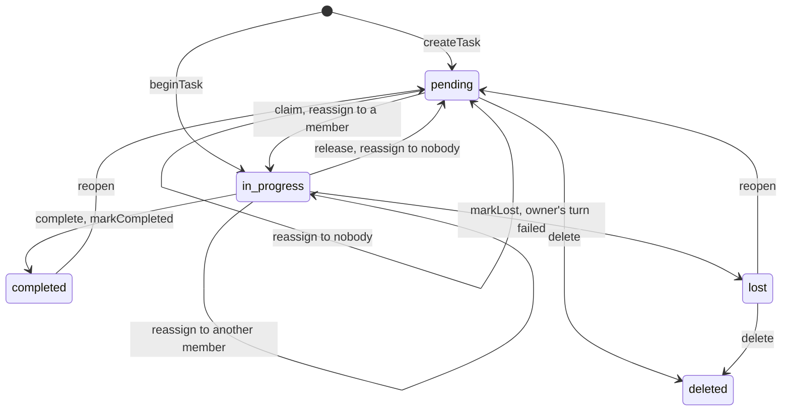
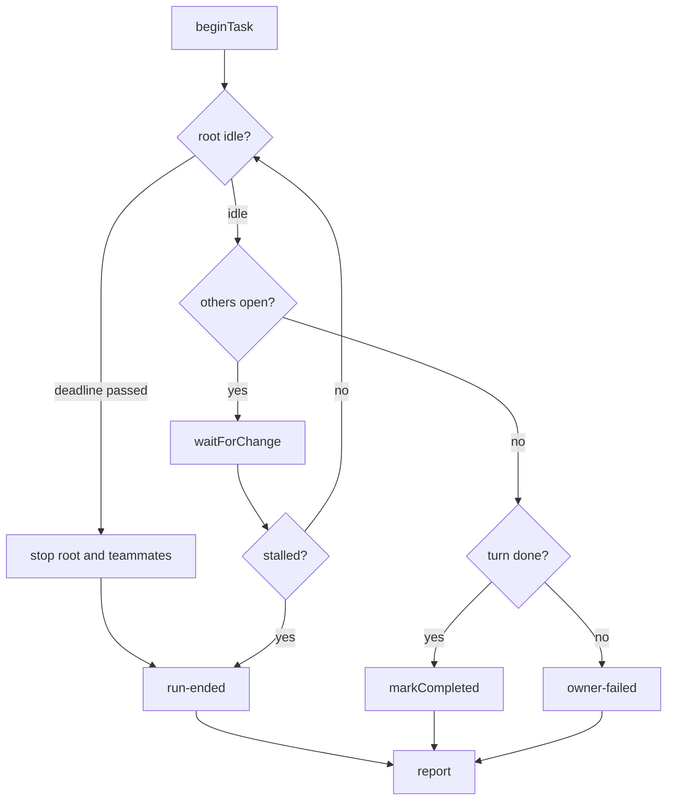

# Agent Teams

English | [中文](agent-team.zh.md)

Types shared by the experimental implicit-root Team domain, model tools, and host adapters. The [Agent Teams Agent Note](../../.agents/notes/implemented/feature/2026-08-05-agent-teams.md) owns identity, mailbox, task, and shared-checkout decisions; this page records the literal durable forms from [`packages/experimental/agent-team/src/types.ts`](../../packages/experimental/agent-team/src/types.ts).

## Identity and roster

`TeamId` is the root `SessionId` under a distinct [brand](core.md#branded-ids). `TeamTaskId` is Team-local and monotonically allocated as `task-<n>`; `TeamMessageId` is globally random. A teammate's Session id remains its persistent identity, while `name` is an immutable model/UI label.

```ts type-equiv
/** Whole durable value written on every teammate lifecycle change. */
interface TeamMemberSnapshot {
  readonly id: SessionId
  readonly name: string
  readonly description: string
  readonly provider: string
  readonly context: 'fresh' | 'fork'
  readonly phase: TeamMemberPhase
  readonly error?: string
}
```

Every member starts in `provisioning` and reaches exactly one terminal roster phase, `active` or `failed`. Roster `running`/`inactive` status is derived separately and never rewrites this record.

## Durable mailbox

The Lead Session first stores the complete queued message. A target receipt is acknowledged only after its pending inbox item or recorded user message is durable, leaving queued-minus-delivered as the recovery mailbox.

```ts type-equiv
/** One peer message retained until its target Session records it. */
interface TeamMessageSnapshot {
  readonly id: TeamMessageId
  readonly senderId: SessionId
  readonly senderName: string
  readonly targetId: SessionId
  readonly content: ContentBlock[]
}
```

Every message attempts Steer delivery. A running target receives it at the nearest step boundary; an inactive target starts a turn if loaded or cold-resumes otherwise. Scheduling is not stored in the durable record because callers cannot select another mode.

The target Session keeps message identity and sender attribution on both the pending inbox item and the eventual user message. Folding that source across inbox and history is the target-side de-duplication key; the model-visible framing repeats the id and sender.

```ts type-equiv
/** Source retained by the target Session for durable mailbox de-duplication. */
interface TeamMessageSource {
  readonly kind: 'team-message'
  readonly teamId: TeamId
  readonly messageId: TeamMessageId
  readonly senderId: SessionId
  readonly senderName: string
}
```

## Shared task DAG

Every task event stores a complete snapshot. `revision` is the compare-and-set value and increments by one per mutation. `blockedBy` edges must name non-deleted tasks and keep the graph acyclic. `writeScopes` are normalized advisory path prefixes rather than locks.

```ts type-equiv
/**
 * Whole durable task snapshot, one variant per status. The variants state
 * which of `ownerId`, `lostCause`, and `ownerGoalRevision` a status carries,
 * so a snapshot with the wrong fields for its status does not compile and is
 * refused when read.
 */
type TeamTaskSnapshot =
  | PendingTeamTask
  | InProgressTeamTask
  | CompletedTeamTask
  | LostTeamTask
  | DeletedTeamTask
```

Every variant carries `id`, `revision`, `subject`, `description`, `blockedBy`, and `writeScopes`, and may carry `goalRevision` and `attempts`. The status decides the owner and cause fields, and the `team/task` version 3 validation refuses a record that breaks a row of this table.

| Status | Meaning | `ownerId` | `lostCause` |
|---|---|---|---|
| `pending` | nobody owns the task yet, or its owner gave it back | absent | absent |
| `in_progress` | its owner is working on it | required | absent |
| `completed` | finished; satisfies the tasks it blocks | required: the owner that held it when it completed | absent |
| `lost` | its owner is gone | required: the owner that held it | required: `owner-failed` or `run-ended` |
| `deleted` | retained tombstone | optional: kept from a `lost` task | absent |

`lost` means only that the owner is gone. `owner-failed` records that the owning member's turn, or the owning tracked run, ended without completing the task; `run-ended` records that a run ended before the task finished. `lost` says nothing about whether finished work was accepted, so a later acceptance check needs its own record. A `lost` task may also carry `ownerGoalRevision`, described below; no other status does.

**Attempts and the goal.** A task records its earlier ownerships in `attempts`, in the order they ended. An attempt names the owner and how the ownership ended: `released` when the owner or the Lead returned the task to `pending`, `reassigned` when the Lead moved it to another member, and `completed` or `lost` when the task was reopened from that status, with the `lostCause` it had. `release`, `reassign`, and `reopen` accept a `reason`, which is recorded on the attempt the action ends and included in the message the previous owner receives. A reason is feedback on the work: it leaves `subject` and `description` unchanged. `edit` changes the goal, and an edit of `subject` or `description` sets `goalRevision` to the new revision; each attempt records the `goalRevision` its owner worked toward, so a reader can tell a second attempt at the same goal from an attempt at a changed one. An attempt with no `goalRevision`, or with 1, worked toward the text the task was created with. A `lost` task can be edited before it is reopened, and its owner never saw that edit: the first such edit stores the goal the owner had as `ownerGoalRevision` on the lost task, and `reopen` records that value on the attempt. `attempts` and `goalRevision` are absent until they have something to record.

Three groups of statuses are defined once, in `task-status.ts`, and every decision uses them. A task is *outstanding* while it is `in_progress`: a run that follows the board waits only on outstanding tasks. A task is *open* while it is `pending` or `lost`: its text, edges, and existence may change. A task is *started* while it is `in_progress` or `completed`: it is frozen, and every task in its `blockedBy` is `completed`. Views add owner name, readiness, lost cause, and write-scope overlap warnings without changing the durable snapshot.

<a id="task-status-transitions"></a>

### Task status transitions

Every task follows one state machine, whoever owns it: the Lead, a teammate, or a tracked subagent run. Members differ in the tools they hold, not in how their tasks move.



A transition has one of two origins. A member action goes through `updateTask`, which compares `expectedRevision` and requires the caller named in the table. A harness transition goes through `beginTask`, `markCompleted`, or `markLost`, or follows from a member's turn ending, and skips member authorization because no member acted.

| Transition | From | To | Origin | Condition |
|---|---|---|---|---|
| `createTask` | none | `pending` | member | board below `maxTasks` |
| `beginTask` | none | `in_progress` | harness | the owner is the calling member; a tracked run's row is owned by the run's child Session |
| `claim` | `pending` | `in_progress` | member | every blocker is `completed` |
| `reassign` to a member | `pending`, `in_progress` | `in_progress` | Lead | every blocker is `completed`; the new owner is an active member other than the current owner; the owner of an `in_progress` task is a member |
| `release` | `in_progress` | `pending` | owner or Lead | clears the owner; the owner is a member |
| `reassign` to nobody | `pending`, `in_progress` | `pending` | Lead | clears the owner; on a `pending` task it only increments the revision; the owner of an `in_progress` task is a member |
| `complete` | `in_progress` | `completed` | owner or Lead | the owner is a member |
| `markCompleted` | `in_progress` | `completed` | harness | the task is still held by the owner the harness names |
| `markLost` | `in_progress` | `lost` | harness | records `lostCause`; keeps the owner; with `owner-failed`, the task is still held by the owner the harness names |
| owner's turn failed | `in_progress` | `lost` | harness | a member's turn ended any way other than `completed` or `aborted`; every task it owns is lost as `owner-failed` |
| `reopen` | `completed`, `lost` | `pending` | owner or Lead | clears the owner and `lostCause`; a `completed` task has no started dependent |
| `edit`, `set_dependencies` | `pending`, `lost` | unchanged | Lead; also the owner of a `lost` task | |
| `delete` | `pending`, `lost` | `deleted` | Lead; also the owner of a `lost` task | no remaining task names it in `blockedBy`; drops `lostCause` |

A `pending` task has no owner, so only the Lead passes the "owner or Lead" check on it. `lost` is never a member action and is not terminal. A lost task cannot be claimed or completed and keeps blocking its dependents; `reopen` is its only way back to `pending`. A claim that is refused names the reason for the task's status: a blocker that is not completed, another owner, or the `reopen` a lost or completed task needs first. A request outside the table is refused and leaves the task unchanged.

**Reopening a completed task.** `reopen` is refused with `TEAM_TASK_HAS_DEPENDENTS` while a task that names it in `blockedBy` is started. The dependent is released, unassigned, or reopened first, so a started task never has a blocker that is not completed. A `lost` task was never completed, so nothing that depends on it has started.

**Taking a task from its owner.** The Lead can unassign, reassign, or complete a task another member is working on. Reassignment to another member is one transition, so the task is never `pending` between the two owners and no third member can claim it. After any of the three, the previous owner receives a Team mailbox message from the Lead that names the task and what happened and tells it to stop. A previous owner that holds no other in-progress task has its current turn interrupted, and reads the message when it next runs; one that holds another task is steered at its next step and keeps its turn. A message that cannot be queued is logged and does not undo the task change.

**Harness transitions name the owner.** `markCompleted`, and `markLost` for an owner that failed, state which owner the harness observed. The transition is refused with `TEAM_TASK_INVALID_TRANSITION` when the task has since moved to another owner, so the end of one owner's turn or run never settles a task another member holds. `markLost` with `run-ended` names no owner: the end of the run loses the task whoever holds it.

**The row of a tracked run.** A row recorded through `trackSubagentRuns` is owned by the run's child Session, which is not a member and has no mailbox. `release`, `reassign`, and `complete` on it are refused with `TEAM_TASK_INVALID_TRANSITION`; the row settles when the run ends. Once it is `lost`, the Lead can reopen it as an ordinary `pending` task.

**A member turn that fails.** When an active member's turn ends with a stop reason other than `completed` or `aborted`, the tasks it owns become `lost` with `owner-failed`. A completed turn leaves them in progress, because a member may end a turn while it waits for a message. An aborted turn was interrupted on purpose and the member can continue.

<a id="headless-settlement"></a>

## Headless settlement

`agent-team-settlement` provides the headless runner's `ctx.headlessSettlement` over the task board. It decides when a one-shot run ends and reports what the run did not collect. Without it the runner exits when the root's turn ends.

The plugin adds no status of its own. When a run begins, it marks every task already `in_progress` as `lost` with `run-ended`, because no turn has run in this process and that work was left by an earlier process. It then records the task the run was started with through `beginTask`, as an `in_progress` task the root owns, and from there makes only the harness transitions `markCompleted` and `markLost`.



`run-ended` and `owner-failed` are `markLost` causes: the first marks every task still `in_progress`, the second only the run's task. "Others open" asks whether any task is `in_progress` other than the run's task held by the root; "stalled" means a full `stallMs` passed with no Team change while no owner was running.

| Outcome | Condition | Board record |
|---|---|---|
| Settled | no other task is `in_progress`, the root holds the run's task, and the root's latest turn completed | the run's task is `completed` |
| Root failed | no other task is `in_progress` and the root's latest turn ended any other way, or no turn ran | the run's task is `lost`, `owner-failed` |
| Deadline | `deadlineMs` passed since the run began | the root's turn is cancelled and every running teammate's turn is interrupted; every `in_progress` task is `lost`, `run-ended` |
| Stall | no owner is running and no Team change arrived for `stallMs` | every `in_progress` task is `lost`, `run-ended` |

The root's turn settles the run's task only while the root holds it. When the root reassigned that task to a teammate, it is waited on like any other task and the teammate completes it. While any owner is running, the wait lasts until the deadline, so a slow teammate is not a stall. When less than `stallMs` remains before the deadline, the wait ends at the deadline and the outcome is Deadline, not Stall. After the deadline the plugin waits at most `stopGraceMs` for the root and the interrupted teammates to become idle, then reports without them, so a run ends at most `deadlineMs + stopGraceMs` after it began.

**What is reported.** Every outcome ends with the same report: each task that this run created or changed and that is not `completed` or `deleted` when the run ends. That covers a task still `in_progress` because its `markLost` failed, a task that became `lost` during the run for any cause, and a `pending` task nobody started. A task that was on the board before the run began and still has the revision it had then is not reported; it belongs to an earlier run. Each row carries the task id, subject, owner, status, and reason. A task that leaves `in_progress` between the listing and its `markLost` keeps the status its owner gave it and is reported by that status.

The runner writes one `dsh: unsettled: <id> "<subject>" owned by <owner>: <reason>` line to stderr per row, without the `owned by` part for a task that has no owner, puts the rows on the `final` event as `unsettled` under `--json`, and exits 0 only when the root's turn completed and no row was reported.

## Replay

`foldTeam()` replays one root Session into the roster, task board, and queued-minus-delivered mailbox that every Team operation reads. It selects records by `TeamId`, so events inherited by an ordinary fork retain the ancestor id and never enter the new root's state. Session event `seq` and `time` remain the ordering and timing record; Team snapshots do not duplicate them. Roster and task reads reach callers as views; pending mail stays internal to delivery and recovery. `team/task` payloads are written at version 3, which adds `lost` and `lostCause`; version 2 payloads remain readable. The package [README](../../packages/experimental/agent-team/README.md) owns operation, authorization, recovery, and limit behavior.

<!-- BEGIN GENERATED cordis-surface (gen-cordis-catalog.ts) — do not edit between markers -->

<a id="cordis-surface"></a>

## Cordis API

Generated from source by `scripts/gen-cordis-catalog.ts` (verified fresh by `pnpm run verify-cordis-catalog` in doc-sync; regenerate with `pnpm run gen-cordis-catalog`) — the language sides differ only in locale-specific paired document paths. Signature blocks use a `ts cordis-catalog` fence and keep the original source JSDoc; dispatch modes are defined in the [primer](../cordis-primer.md#dispatch-modes), and the framework-inherited `ctx` API lives in [cordis-api/inherited.md](../cordis-api/inherited.md).

<a id="ctxagentteams--teamservice"></a>

### `ctx.agentTeams` — `TeamService`

Agent Teams service backed by the exact live Lead Session log.

```ts cordis-catalog
/**
 * Resolve one exact live Agent's Team role.
 * @param agent - exact live Agent used as the authority credential.
 * @returns its root, Team identity, role, and model-facing name.
 */
membership(agent: Agent): TeamMembership

/**
 * List the runtime-enriched roster visible to one Team member.
 * @param agent - exact live Team member.
 * @returns Lead and teammate rows in creation order.
 */
listMembers(agent: Agent): TeamMemberView[]

/**
 * Create one named, continuable direct child of the Team Lead.
 * @param caller - exact live Lead Agent.
 * @param request - immutable name, description, prompt, context mode, provider, and cancellation.
 * @returns the active roster row.
 */
async spawnTeammate(caller: Agent, request: SpawnTeammateRequest): Promise<SpawnTeammateResult>

/**
 * Queue one durable peer message, then attempt immediate delivery.
 * @param caller - exact live sending Team member.
 * @param request - target name, content, and pre-queue cancellation.
 * @returns durable message identity and immediate-delivery observation.
 */
async sendMessage(caller: Agent, request: SendTeamMessageRequest): Promise<SendTeamMessageResult>

/**
 * Create one unowned pending task in the Team Lead log.
 * @param caller - exact live Team member creating the task.
 * @param request - task text, blockers, and advisory write scopes.
 * @returns the revision-one task view.
 */
async createTask(caller: Agent, request: CreateTeamTaskRequest): Promise<TeamTaskView>

/**
 * Return one task, including a deleted tombstone.
 * @param caller - exact live Team member reading the task.
 * @param id - Team-local task identity.
 * @returns the latest task value and derived readiness diagnostics.
 */
getTask(caller: Agent, id: TeamTaskId): TeamTaskView

/**
 * List current non-deleted tasks in numeric creation order.
 * @param caller - exact live Team member reading the board.
 * @returns detached current task views.
 */
listTasks(caller: Agent): TeamTaskView[]

/**
 * Compare-and-set one authorized task transition. When the Lead takes an
 * in-progress task from a teammate, by unassigning it, reassigning it, or
 * completing it, the teammate is told through its Team mailbox; a teammate
 * that then holds no other in-progress task has its current turn interrupted.
 * @param caller - exact live Team member authorizing the mutation.
 * @param request - task identity, expected revision, action, and action fields.
 * @returns the committed next task revision.
 */
async updateTask(caller: Agent, request: UpdateTeamTaskRequest): Promise<TeamTaskView>

/**
 * Record work the caller has already begun as an in-progress task it owns.
 * Any member may be the caller; the harness uses it for work no member
 * created a task for, such as the request a run was started with.
 * @param caller - exact live Team member that owns the work.
 * @param request - subject and description of the work.
 * @returns the revision-one task view, in progress and owned by the caller.
 */
async beginTask(caller: Agent, request: Pick<CreateTeamTaskRequest, 'subject' | 'description'>): Promise<TeamTaskView>

/**
 * Complete one in-progress task on behalf of the harness, bypassing member authorization.
 * @param caller - exact live Team member whose board holds the task.
 * @param id - task the harness observed finished.
 * @param ownerId - the owner the harness observed finishing it. A task another owner holds is
 *   refused with `TEAM_TASK_INVALID_TRANSITION`.
 * @returns the completed task view.
 */
async markCompleted(caller: Agent, id: TeamTaskId, ownerId: SessionId): Promise<TeamTaskView>

/**
 * List in-progress tasks on the caller's Team board with whether each owner is still running.
 * @param caller - exact live Team member reading the board.
 * @returns outstanding rows in creation order; empty once every claimed task settled.
 */
outstandingTasks(caller: Agent): OutstandingTeamTask[]

/**
 * Mark one in-progress task `lost` on behalf of the harness; the owner stays recorded.
 * @param caller - exact live Team member whose board holds the task.
 * @param id - task whose owner can no longer finish it.
 * @param cause - why the harness gave up on the owner.
 * @param ownerId - the owner the harness gave up on. A task another owner holds is refused with
 *   `TEAM_TASK_INVALID_TRANSITION`. Omit it when the run itself ended, which loses the task whoever holds it.
 * @returns the lost task view.
 */
async markLost(caller: Agent, id: TeamTaskId, cause: TeamTaskLostCause, ownerId?: SessionId): Promise<TeamTaskView>

/**
 * Wait for the next Team-domain or member-status change.
 * @param caller - exact live Team member waiting for activity.
 * @param timeoutMs - bounded wait duration from ten seconds through one hour.
 * @param signal - caller cancellation for the wait only.
 * @returns one observed change or a timeout result.
 */
async waitForChange(caller: Agent, timeoutMs: number, signal: AbortSignal): Promise<TeamWaitResult>

/**
 * Interrupt one live teammate turn without clearing its pending inbox.
 * @param caller - exact live Lead Agent.
 * @param targetName - durable teammate name.
 * @returns the target status sampled before cancellation.
 */
interrupt(caller: Agent, targetName: string): { previousStatus: 'running' | 'inactive' }

/**
 * Interrupt the current turn of every running teammate and wait until each is idle.
 * Pending inboxes are kept. The harness uses it when a run ends with teammates still working.
 * @param caller - exact live Lead Agent.
 * @returns the names of the teammates that were running, in roster order.
 */
async interruptTeammates(caller: Agent): Promise<string[]>

/**
 * Resolve a caller without throwing, used by scoped-tool installation and observers.
 * @param agent - candidate exact live Agent.
 * @returns Team membership, or undefined for non-Team subagents and stale identities.
 */
tryMembership(agent: Agent): TeamMembership | undefined

/**
 * Read the current roster and non-deleted task board through the generated Remote API.
 * @param agent - exact live Team member used as the authority credential.
 * @returns detached current roster and task views.
 */
@Remote('view') remoteView(agent: Agent): TeamView
```

Types: [Agent](core.md) · [SessionId](core.md)

Source: [`packages/experimental/agent-team/src/index.ts`](../../packages/experimental/agent-team/src/index.ts)
<!-- END GENERATED cordis-surface -->
