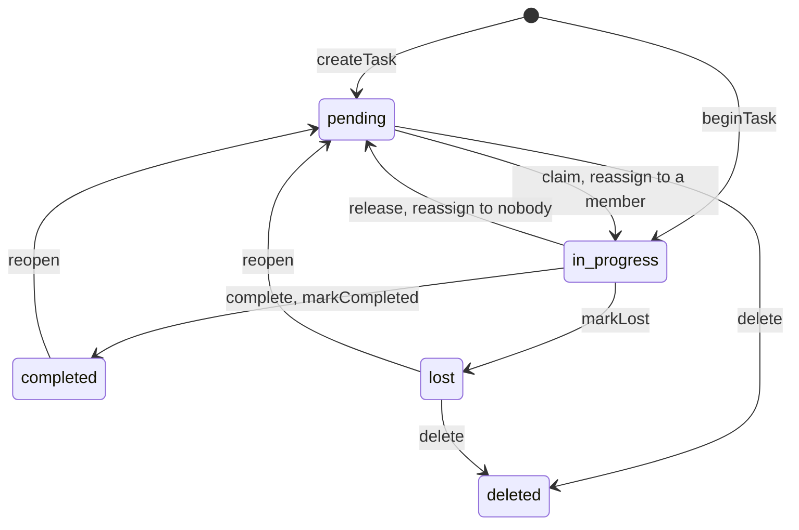
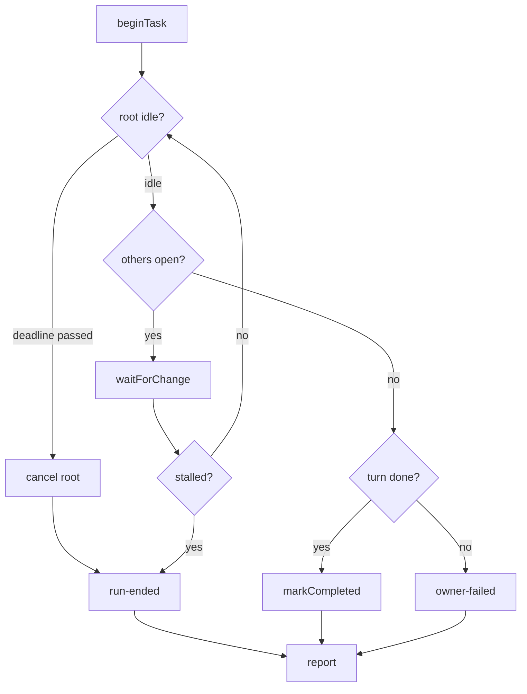

# Agent Teams

[English](agent-team.md) | 中文

实验性隐式 Root Team 领域、模型工具与宿主适配器共享的类型。[Agent Teams Agent Note](../../.agents/notes/implemented/feature/2026-08-05-agent-teams.zh.md)负责身份、mailbox、task 与共享 checkout 决策；本页记录 [`packages/experimental/agent-team/src/types.ts`](../../packages/experimental/agent-team/src/types.ts) 中的字面持久形式。

## 身份与 roster

`TeamId` 是具有独立[品牌](core.zh.md#branded-ids)的 Root `SessionId`。`TeamTaskId` 在 Team 内按 `task-<n>` 单调分配；`TeamMessageId` 是全局随机值。teammate 的 Session id 始终是持久身份，而 `name` 是不可变的模型／UI 标签。

```ts type-equiv
/** Whole durable value written on every teammate lifecycle change. */
interface TeamMemberSnapshot {
  readonly id: SessionId
  readonly name: string
  readonly description: string
  readonly provider: string
  readonly context: 'fresh' | 'fork'
  readonly phase: TeamMemberPhase
  readonly error?: string
}
```

每个 member 都从 `provisioning` 开始，并且只到达一个终态 roster phase：`active` 或 `failed`。roster 的 `running`／`inactive` 状态单独派生，绝不会重写该记录。

## 持久 mailbox

Lead Session 首先存储完整 queued message。只有 target 的 pending inbox 条目或已记录用户消息完成持久化，才会写入独立 acknowledgement event，queued-minus-delivered 因而构成恢复 mailbox。

```ts type-equiv
/** One peer message retained until its target Session records it. */
interface TeamMessageSnapshot {
  readonly id: TeamMessageId
  readonly senderId: SessionId
  readonly senderName: string
  readonly targetId: SessionId
  readonly content: ContentBlock[]
}
```

每条消息都会尝试 Steer 投递。running target 在最近的步骤边界收到消息，inactive target 在已加载时启动一个轮次，否则冷恢复。调用方不能选择其他模式，因此持久记录不存储调度方式。

target Session 会在 pending inbox 条目和最终用户消息上保留消息身份与发送者归因。跨 inbox 与历史折叠该 source 构成 target 侧去重键；模型可见的 framing 会重复 id 和发送者。

```ts type-equiv
/** Source retained by the target Session for durable mailbox de-duplication. */
interface TeamMessageSource {
  readonly kind: 'team-message'
  readonly teamId: TeamId
  readonly messageId: TeamMessageId
  readonly senderId: SessionId
  readonly senderName: string
}
```

## 共享任务 DAG

每条 task event 都存储完整快照。`revision` 是 compare-and-set 值，每次变更递增 1。`blockedBy` edge 必须指向未删除任务，并维持无环图。`writeScopes` 是规范化的提示性路径前缀，不是锁。

```ts type-equiv
/** Whole durable task snapshot; every mutation increments {@link revision}. */
interface TeamTaskSnapshot {
  readonly id: TeamTaskId
  readonly revision: number
  readonly subject: string
  readonly description: string
  readonly status: TeamTaskStatus
  readonly ownerId?: SessionId
  /** Present exactly while {@link status} is `lost`. */
  readonly lostCause?: TeamTaskLostCause
  readonly blockedBy: TeamTaskId[]
  readonly writeScopes: string[]
}
```

`pending` 表示尚未开始或已经释放，`in_progress` 携带 owner，`completed` 满足 blocker，`lost` 是 harness 已放弃其 owner 的进行中任务（`lostCause` 为 `owner-failed` 或 `run-ended`；owner 记录保留到 `reopen` 为止），`deleted` 是保留的 tombstone。`in_progress` 与 `completed` 任务是冻结的：其文本、边与分配不再改变。view 会添加 owner name、readiness、lost cause 和 write-scope 重叠警告，但不会改变持久快照。

<a id="task-status-transitions"></a>

### 任务状态转换

每个任务都遵循同一个状态机，无论 owner 是 Lead、teammate 还是被跟踪的 subagent 运行。成员之间的差别在于持有的工具，而不在于任务如何转换。



转换有两种来源。成员动作经过 `updateTask`，它要求调用方是任务的 owner 或 Lead，并比较 `expectedRevision`。harness 转换经过 `beginTask`、`markCompleted` 或 `markLost`，它们跳过成员授权，因为没有成员发起动作。

| 转换 | 起始 | 目标 | 来源 | 条件 |
|---|---|---|---|---|
| `createTask` | 无 | `pending` | 成员 | 任务板未达到 `maxTasks` |
| `beginTask` | 无 | `in_progress` | harness | 调用方成为 owner |
| `claim` | `pending` | `in_progress` | 成员 | 每个 blocker 都是 `completed`；没有其他 owner |
| `reassign` 给成员 | `pending` | `in_progress` | Lead | 每个 blocker 都是 `completed` |
| `release` | `in_progress` | `pending` | owner 或 Lead | 清除 owner |
| `reassign` 给无人 | `pending`、`in_progress` | `pending` | Lead | 清除 owner |
| `complete` | `in_progress` | `completed` | owner 或 Lead | |
| `markCompleted` | `in_progress` | `completed` | harness | |
| `markLost` | `in_progress` | `lost` | harness | 记录 `lostCause`；保留 owner |
| `reopen` | `completed`、`lost` | `pending` | owner 或 Lead | 清除 owner 与 `lostCause` |
| `delete` | `pending`、`lost` | `deleted` | owner 或 Lead | 没有其他任务在 `blockedBy` 中引用它 |

`lost` 从来不是成员动作，也不是终态。lost 任务不能被 claim 或完成，并继续阻塞依赖它的任务；`reopen` 是它回到 `pending` 的唯一途径。`edit`、`set_dependencies` 与 `delete` 只适用于 `pending` 与 `lost` 任务，因此图中已执行的部分保持 owner 运行时的样子。表外的请求会被拒绝，任务保持不变。

<a id="headless-settlement"></a>

## Headless 结算

`agent-team-settlement` 在任务板之上提供 headless runner 的 `ctx.headlessSettlement`。它决定一次性运行何时结束，并记录运行没有收回的工作。没有它时，runner 在 Root 的 turn 结束时退出。

该插件不增加自己的状态。它通过 `beginTask` 把启动运行的任务记录为 Root 拥有的 `in_progress` 任务，此后只做 harness 转换 `markCompleted` 与 `markLost`。



`run-ended` 与 `owner-failed` 是 `markLost` 的原因：前者标记所有仍处于 `in_progress` 的任务，后者只标记运行的任务。“others open”问的是除运行的任务外是否还有任务处于 `in_progress`；“stalled”表示等待超时且没有 owner 在运行。

| 结果 | 条件 | 任务板记录 | 是否报告为 unsettled |
|---|---|---|---|
| 已结算 | 没有其他任务处于 `in_progress`，且 Root 最近的 turn 已完成 | 运行的任务为 `completed` | 否 |
| Root 失败 | 没有其他任务处于 `in_progress`，且 Root 最近的 turn 以其他方式结束，或没有 turn 运行过 | 运行的任务为 `lost`，`owner-failed` | 是 |
| 截止时间 | 运行开始后已过 `deadlineMs` | Root 的 turn 被取消；每个 `in_progress` 任务为 `lost`，`run-ended` | 是 |
| 停滞 | 没有 owner 在运行，且 `stallMs` 内没有 Team 变化 | 每个 `in_progress` 任务为 `lost`，`run-ended` | 是 |
| 任务被移走 | Root 把运行的任务移出 `in_progress` 却没有完成它 | 不变 | 是 |

只要有 owner 在运行，等待就持续到截止时间，因此较慢的 teammate 不算停滞。在列出与 `markLost` 之间离开 `in_progress` 的任务既不被标记也不被报告。因其他原因失败的 `markLost` 会连同该失败一起报告。

runner 为每个报告行向 stderr 写一行 `dsh: unsettled: <row>`，仅当 Root 的 turn 已完成且没有报告行时以 0 退出。

## 回放

`foldTeam()` 把一个 Root Session 回放成每个 Team 操作所读取的 roster、任务板与 queued-minus-delivered mailbox。它按 `TeamId` 选取记录，因此普通 fork 继承的 event 保留 ancestor id，绝不会进入新 Root 的状态。Session event 的 `seq` 与 `time` 继续负责顺序和时间记录，Team snapshot 不再重复保存它们。roster 与 task 读取以 view 形式到达调用方，而 pending 邮件仅供投递与恢复内部使用。`team/task` payload 以版本 3 写入，新增 `lost` 与 `lostCause`；版本 2 的 payload 仍可读取。包 [README](../../packages/experimental/agent-team/README.zh.md)负责 operation、authorization、recovery 和限制行为。

<!-- BEGIN GENERATED cordis-surface (gen-cordis-catalog.ts) — do not edit between markers -->

<a id="cordis-surface"></a>

## Cordis API

Generated from source by `scripts/gen-cordis-catalog.ts` (verified fresh by `pnpm run verify-cordis-catalog` in doc-sync; regenerate with `pnpm run gen-cordis-catalog`) — the language sides differ only in locale-specific paired document paths. Signature blocks use a `ts cordis-catalog` fence and keep the original source JSDoc; dispatch modes are defined in the [primer](../cordis-primer.zh.md#dispatch-modes), and the framework-inherited `ctx` API lives in [cordis-api/inherited.md](../cordis-api/inherited.md).

<a id="ctxagentteams--teamservice"></a>

### `ctx.agentTeams` — `TeamService`

Agent Teams service backed by the exact live Lead Session log.

```ts cordis-catalog
/**
 * Resolve one exact live Agent's Team role.
 * @param agent - exact live Agent used as the authority credential.
 * @returns its root, Team identity, role, and model-facing name.
 */
membership(agent: Agent): TeamMembership

/**
 * List the runtime-enriched roster visible to one Team member.
 * @param agent - exact live Team member.
 * @returns Lead and teammate rows in creation order.
 */
listMembers(agent: Agent): TeamMemberView[]

/**
 * Create one named, continuable direct child of the Team Lead.
 * @param caller - exact live Lead Agent.
 * @param request - immutable name, description, prompt, context mode, provider, and cancellation.
 * @returns the active roster row.
 */
async spawnTeammate(caller: Agent, request: SpawnTeammateRequest): Promise<SpawnTeammateResult>

/**
 * Queue one durable peer message, then attempt immediate delivery.
 * @param caller - exact live sending Team member.
 * @param request - target name, content, and pre-queue cancellation.
 * @returns durable message identity and immediate-delivery observation.
 */
async sendMessage(caller: Agent, request: SendTeamMessageRequest): Promise<SendTeamMessageResult>

/**
 * Create one unowned pending task in the Team Lead log.
 * @param caller - exact live Team member creating the task.
 * @param request - task text, blockers, and advisory write scopes.
 * @returns the revision-one task view.
 */
async createTask(caller: Agent, request: CreateTeamTaskRequest): Promise<TeamTaskView>

/**
 * Return one task, including a deleted tombstone.
 * @param caller - exact live Team member reading the task.
 * @param id - Team-local task identity.
 * @returns the latest task value and derived readiness diagnostics.
 */
getTask(caller: Agent, id: TeamTaskId): TeamTaskView

/**
 * List current non-deleted tasks in numeric creation order.
 * @param caller - exact live Team member reading the board.
 * @returns detached current task views.
 */
listTasks(caller: Agent): TeamTaskView[]

/**
 * Compare-and-set one authorized task transition.
 * @param caller - exact live Team member authorizing the mutation.
 * @param request - task identity, expected revision, action, and action fields.
 * @returns the committed next task revision.
 */
async updateTask(caller: Agent, request: UpdateTeamTaskRequest): Promise<TeamTaskView>

/**
 * Record work the caller has already begun as an in-progress task it owns.
 * Any member may be the caller; the harness uses it for work no member
 * created a task for, such as the request a run was started with.
 * @param caller - exact live Team member that owns the work.
 * @param request - subject and description of the work.
 * @returns the revision-one task view, in progress and owned by the caller.
 */
async beginTask(caller: Agent, request: Pick<CreateTeamTaskRequest, 'subject' | 'description'>): Promise<TeamTaskView>

/**
 * Complete one in-progress task on behalf of the harness, bypassing member authorization.
 * @param caller - exact live Team member whose board holds the task.
 * @param id - task the harness observed finished.
 * @returns the completed task view.
 */
async markCompleted(caller: Agent, id: TeamTaskId): Promise<TeamTaskView>

/**
 * List in-progress tasks on the caller's Team board with whether each owner is still running.
 * @param caller - exact live Team member reading the board.
 * @returns outstanding rows in creation order; empty once every claimed task settled.
 */
outstandingTasks(caller: Agent): OutstandingTeamTask[]

/**
 * Mark one in-progress task `lost` on behalf of the harness; the owner stays recorded.
 * @param caller - exact live Team member whose board holds the task.
 * @param id - task whose owner can no longer finish it.
 * @param cause - why the harness gave up on the owner.
 * @returns the lost task view.
 */
async markLost(caller: Agent, id: TeamTaskId, cause: TeamTaskLostCause): Promise<TeamTaskView>

/**
 * Wait for the next Team-domain or member-status change.
 * @param caller - exact live Team member waiting for activity.
 * @param timeoutMs - bounded wait duration from ten seconds through one hour.
 * @param signal - caller cancellation for the wait only.
 * @returns one observed change or a timeout result.
 */
async waitForChange(caller: Agent, timeoutMs: number, signal: AbortSignal): Promise<TeamWaitResult>

/**
 * Interrupt one live teammate turn without clearing its pending inbox.
 * @param caller - exact live Lead Agent.
 * @param targetName - durable teammate name.
 * @returns the target status sampled before cancellation.
 */
interrupt(caller: Agent, targetName: string): { previousStatus: 'running' | 'inactive' }

/**
 * Resolve a caller without throwing, used by scoped-tool installation and observers.
 * @param agent - candidate exact live Agent.
 * @returns Team membership, or undefined for non-Team subagents and stale identities.
 */
tryMembership(agent: Agent): TeamMembership | undefined

/**
 * Read the current roster and non-deleted task board through the generated Remote API.
 * @param agent - exact live Team member used as the authority credential.
 * @returns detached current roster and task views.
 */
@Remote('view') remoteView(agent: Agent): TeamView
```

Types: [Agent](core.zh.md)

Source: [`packages/experimental/agent-team/src/index.ts`](../../packages/experimental/agent-team/src/index.ts)
<!-- END GENERATED cordis-surface -->
