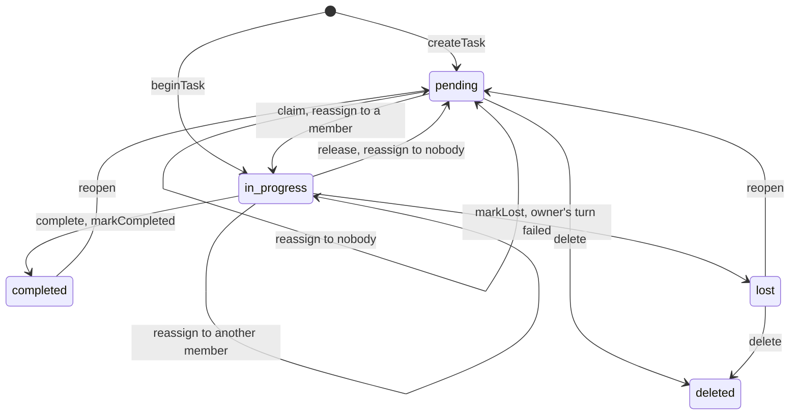
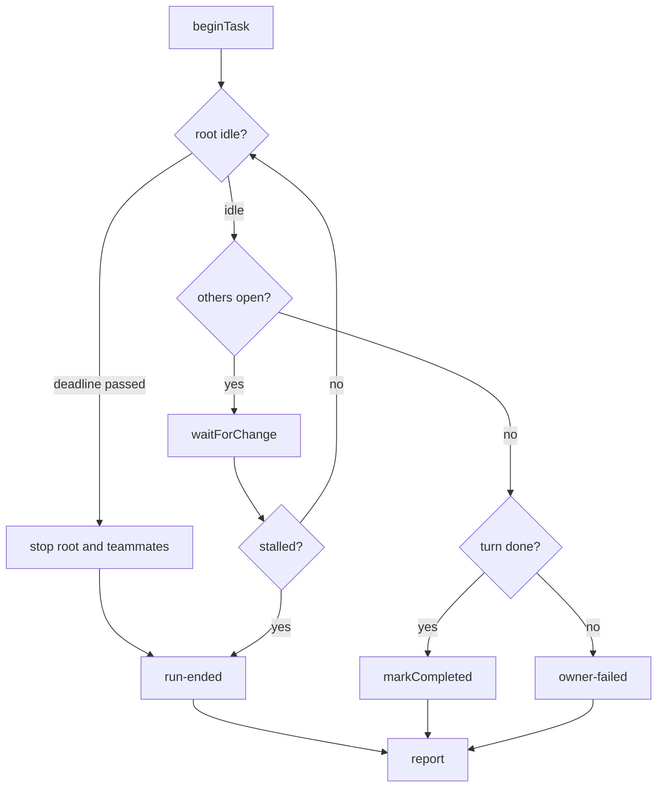

# Agent Teams

[English](agent-team.md) | 中文

实验性隐式 Root Team 领域、模型工具与宿主适配器共享的类型。[Agent Teams Agent Note](../../.agents/notes/implemented/feature/2026-08-05-agent-teams.zh.md)负责身份、mailbox、task 与共享 checkout 决策；本页记录 [`packages/experimental/agent-team/src/types.ts`](../../packages/experimental/agent-team/src/types.ts) 中的字面持久形式。

## 身份与 roster

`TeamId` 是具有独立[品牌](core.zh.md#branded-ids)的 Root `SessionId`。`TeamTaskId` 在 Team 内按 `task-<n>` 单调分配；`TeamMessageId` 是全局随机值。teammate 的 Session id 始终是持久身份，而 `name` 是不可变的模型／UI 标签。

```ts type-equiv
/** Whole durable value written on every teammate lifecycle change. */
interface TeamMemberSnapshot {
  readonly id: SessionId
  readonly name: string
  readonly description: string
  readonly provider: string
  readonly context: 'fresh' | 'fork'
  readonly phase: TeamMemberPhase
  readonly error?: string
}
```

每个 member 都从 `provisioning` 开始，并且只到达一个终态 roster phase：`active` 或 `failed`。roster 的 `running`／`inactive` 状态单独派生，绝不会重写该记录。

## 持久 mailbox

Lead Session 首先存储完整 queued message。只有 target 的 pending inbox 条目或已记录用户消息完成持久化，才会写入独立 acknowledgement event，queued-minus-delivered 因而构成恢复 mailbox。

```ts type-equiv
/** One peer message retained until its target Session records it. */
interface TeamMessageSnapshot {
  readonly id: TeamMessageId
  readonly senderId: SessionId
  readonly senderName: string
  readonly targetId: SessionId
  readonly content: ContentBlock[]
}
```

每条消息都会尝试 Steer 投递。running target 在最近的步骤边界收到消息，inactive target 在已加载时启动一个轮次，否则冷恢复。调用方不能选择其他模式，因此持久记录不存储调度方式。

target Session 会在 pending inbox 条目和最终用户消息上保留消息身份与发送者归因。跨 inbox 与历史折叠该 source 构成 target 侧去重键；模型可见的 framing 会重复 id 和发送者。

```ts type-equiv
/** Source retained by the target Session for durable mailbox de-duplication. */
interface TeamMessageSource {
  readonly kind: 'team-message'
  readonly teamId: TeamId
  readonly messageId: TeamMessageId
  readonly senderId: SessionId
  readonly senderName: string
}
```

## 共享任务 DAG

每条 task event 都存储完整快照。`revision` 是 compare-and-set 值，每次变更递增 1。`blockedBy` edge 必须指向未删除任务，并维持无环图。`writeScopes` 是规范化的提示性路径前缀，不是锁。

```ts type-equiv
/**
 * Whole durable task snapshot, one variant per status. The variants state
 * which of `ownerId`, `lostCause`, and `ownerGoalRevision` a status carries,
 * so a snapshot with the wrong fields for its status does not compile and is
 * refused when read.
 */
type TeamTaskSnapshot =
  | PendingTeamTask
  | InProgressTeamTask
  | CompletedTeamTask
  | LostTeamTask
  | DeletedTeamTask
```

每个变体都带有 `id`、`revision`、`subject`、`description`、`blockedBy` 和 `writeScopes`，并可以带有 `goalRevision` 和 `attempts`。owner 与 cause 字段由状态决定，`team/task` 版本 3 的校验会拒绝违反下表任何一行的记录。

| 状态 | 含义 | `ownerId` | `lostCause` |
|---|---|---|---|
| `pending` | 还没有 owner，或 owner 已把任务交回 | 没有 | 没有 |
| `in_progress` | owner 正在做这个任务 | 必有 | 没有 |
| `completed` | 已完成；满足它所阻塞的任务 | 必有：完成时持有它的 owner | 没有 |
| `lost` | owner 已不在 | 必有：当时持有它的 owner | 必有：`owner-failed` 或 `run-ended` |
| `deleted` | 保留的 tombstone | 可选：由 `lost` 任务保留下来 | 没有 |

`lost` 只表示 owner 已不在。`owner-failed` 记录的是持有任务的成员的 turn，或持有任务的被跟踪运行，没有完成任务就结束了；`run-ended` 记录的是运行在任务完成之前结束。`lost` 不说明已完成的工作是否被接受，因此以后的验收检查需要自己的记录。`lost` 任务还可以带有下文说明的 `ownerGoalRevision`，其他状态都不带。

**尝试记录与目标。** 任务在 `attempts` 里按结束的先后记录它之前的每一次持有。每条记录写明 owner 和这次持有如何结束：owner 或 Lead 把任务退回 `pending` 时是 `released`，Lead 把它转给另一个成员时是 `reassigned`，任务从 `completed` 或 `lost` 被 reopen 时是对应的状态，并带上当时的 `lostCause`。`release`、`reassign` 与 `reopen` 接受一个 `reason`，它记录在该动作结束的那次尝试上。只有 Lead 对成员正在做的任务取消指派或重新指派时，该成员收到的消息里才带有这个 reason；`reopen` 和 owner 自己的 `release` 不发消息，它们的 reason 只能通过 `attempts` 被成员读到。reason 是对工作的反馈：它不改变 `subject` 与 `description`。`edit` 改变的是目标，对 `subject` 或 `description` 的编辑会把 `goalRevision` 设为新的 revision；每次尝试记录它的 owner 当时对应的 `goalRevision`，因此读者能分清"对同一个目标的第二次尝试"和"对改过的目标的尝试"。没有 `goalRevision` 或值为 1 的尝试，对应的是任务创建时的文本。`lost` 任务可以在 reopen 之前被编辑，而它的 owner 从未见过这次编辑：第一次这样的编辑会把 owner 当时的目标存为 lost 任务上的 `ownerGoalRevision`，`reopen` 把这个值记到尝试上。`attempts` 与 `goalRevision` 在没有内容可记之前都不出现。

三组状态在 `task-status.ts` 里只定义一次，所有判断都使用它们。任务处于 `in_progress` 时是 *outstanding*：跟随任务板的运行只等待 outstanding 任务。任务处于 `pending` 或 `lost` 时是 *open*：它的文本、边和存在与否都还可以改变。任务处于 `in_progress` 或 `completed` 时是 *started*：它被冻结，并且它的 `blockedBy` 中每个任务都是 `completed`。view 会添加 owner name、readiness、lost cause 和 write-scope 重叠警告，但不会改变持久快照。

<a id="task-status-transitions"></a>

### 任务状态转换

每个任务都遵循同一个状态机，无论 owner 是 Lead、teammate 还是被跟踪的 subagent 运行。成员之间的差别在于持有的工具，而不在于任务如何转换。



转换有两种来源。成员动作经过 `updateTask`，它比较 `expectedRevision`，并要求调用方是表中写明的角色。harness 转换经过 `beginTask`、`markCompleted` 或 `markLost`，或者由成员的 turn 结束引起；它跳过成员授权，因为没有成员发起动作。

| 转换 | 起始 | 目标 | 来源 | 条件 |
|---|---|---|---|---|
| `createTask` | 无 | `pending` | 成员 | 任务板未达到 `maxTasks` |
| `beginTask` | 无 | `in_progress` | harness | owner 是调用它的成员；被跟踪运行的行由该运行的子 Session 持有 |
| `claim` | `pending` | `in_progress` | 成员 | 每个 blocker 都是 `completed` |
| `reassign` 给成员 | `pending`、`in_progress` | `in_progress` | Lead | 每个 blocker 都是 `completed`；新 owner 是 active 成员，且不是当前 owner；`in_progress` 任务的 owner 是成员 |
| `release` | `in_progress` | `pending` | owner 或 Lead | 清除 owner；owner 是成员 |
| `reassign` 给无人 | `pending`、`in_progress` | `pending` | Lead | 清除 owner；对 `pending` 任务只递增 revision；`in_progress` 任务的 owner 是成员 |
| `complete` | `in_progress` | `completed` | owner 或 Lead | owner 是成员 |
| `markCompleted` | `in_progress` | `completed` | harness | 任务仍由 harness 指明的 owner 持有 |
| `markLost` | `in_progress` | `lost` | harness | 记录 `lostCause`；保留 owner；原因为 `owner-failed` 时，任务仍由 harness 指明的 owner 持有 |
| owner 的 turn 失败 | `in_progress` | `lost` | harness | 成员的 turn 以 `completed`、`aborted` 之外的方式结束；它持有的每个任务都以 `owner-failed` 变为 lost |
| `reopen` | `completed`、`lost` | `pending` | owner 或 Lead | 清除 owner 与 `lostCause`；`completed` 任务没有 started 的依赖任务 |
| `edit`、`set_dependencies` | `pending`、`lost` | 不变 | Lead；`lost` 任务的 owner 也可以 | |
| `delete` | `pending`、`lost` | `deleted` | Lead；`lost` 任务的 owner 也可以 | 没有其他任务在 `blockedBy` 中引用它；去掉 `lostCause` |

`pending` 任务没有 owner，所以只有 Lead 能通过它的“owner 或 Lead”检查。`lost` 从来不是成员动作，也不是终态。lost 任务不能被 claim 或完成，并继续阻塞依赖它的任务；`reopen` 是它回到 `pending` 的唯一途径。被拒绝的 claim 会说明与任务状态对应的原因：某个 blocker 没有完成、已有其他 owner，或者 lost、completed 任务需要先 `reopen`。表外的请求会被拒绝，任务保持不变。

**重新打开已完成的任务。** 只要有在 `blockedBy` 中引用它的任务处于 started，`reopen` 就会以 `TEAM_TASK_HAS_DEPENDENTS` 被拒绝。要先释放、取消指派或重新打开那个依赖任务，这样 started 的任务就不会有未完成的 blocker。`lost` 任务从未完成，所以依赖它的任务都没有开始。

**从 owner 手里收走任务。** Lead 可以对其他成员正在做的任务取消指派、重新指派或标成完成。重新指派给另一个成员是一次转换，任务在两个 owner 之间不会处于 `pending`，第三个成员无法在中间 claim 它。这三种操作之后，原 owner 都会收到一条来自 Lead 的 Team mailbox 消息，说明是哪个任务、发生了什么，并要求它停下。原 owner 如果没有其他进行中的任务，当前 turn 会被中断，它下次运行时读到这条消息；如果还持有其他任务，消息会在它的下一个 step 送达，turn 继续。消息无法入队时只记录日志，不会撤销任务变更。

**harness 转换要指明 owner。** `markCompleted`，以及针对失败 owner 的 `markLost`，都要写明 harness 观察到的是哪个 owner。任务此后已经转给另一个 owner 时，转换以 `TEAM_TASK_INVALID_TRANSITION` 被拒绝，因此一个 owner 的 turn 或运行结束，不会结算另一个成员持有的任务。原因为 `run-ended` 的 `markLost` 不指明 owner：运行结束时，不论任务由谁持有都会丢失。

**被跟踪运行的任务行。** 通过 `trackSubagentRuns` 记录的任务行由该运行的子 Session 持有，它不是成员，也没有 mailbox。对它的 `release`、`reassign` 与 `complete` 以 `TEAM_TASK_INVALID_TRANSITION` 被拒绝；这一行在运行结束时结算。它变为 `lost` 之后，Lead 可以把它 reopen 成普通的 `pending` 任务。

**成员的 turn 失败。** active 成员的 turn 以 `completed`、`aborted` 之外的 stop reason 结束时，它持有的任务以 `owner-failed` 变为 `lost`。completed 的 turn 不改变这些任务，因为成员可能在等待消息时结束 turn。aborted 的 turn 是被有意中断的，成员可以继续。

<a id="headless-settlement"></a>

## Headless 结算

`agent-team-settlement` 在任务板之上提供 headless runner 的 `ctx.headlessSettlement`。它决定一次性运行何时结束，并报告运行没有收回的工作。没有它时，runner 在 Root 的 turn 结束时退出。

该插件不增加自己的状态。运行开始时，它把所有已经处于 `in_progress` 的任务以 `run-ended` 标为 `lost`，因为这个进程里还没有 turn 运行过，这些工作是更早的进程留下的。然后它通过 `beginTask` 把启动运行的任务记录为 Root 拥有的 `in_progress` 任务，此后只做 harness 转换 `markCompleted` 与 `markLost`。



`run-ended` 与 `owner-failed` 是 `markLost` 的原因：前者标记所有仍处于 `in_progress` 的任务，后者只标记运行的任务。“others open”问的是除 Root 持有的运行任务外是否还有任务处于 `in_progress`；“stalled”表示在没有 owner 运行的情况下，完整的 `stallMs` 内没有 Team 变化。

| 结果 | 条件 | 任务板记录 |
|---|---|---|
| 已结算 | 没有其他任务处于 `in_progress`，Root 持有运行的任务，且 Root 最近的 turn 已完成 | 运行的任务为 `completed` |
| Root 失败 | 没有其他任务处于 `in_progress`，且 Root 最近的 turn 以其他方式结束，或没有 turn 运行过 | 运行的任务为 `lost`，`owner-failed` |
| 截止时间 | 运行开始后已过 `deadlineMs` | Root 的 turn 被取消，每个正在运行的 teammate 的 turn 被中断；每个 `in_progress` 任务为 `lost`，`run-ended` |
| 停滞 | 没有 owner 在运行，且 `stallMs` 内没有 Team 变化 | 每个 `in_progress` 任务为 `lost`，`run-ended` |

只有 Root 仍持有运行的任务时，才由 Root 的 turn 结算它。Root 把这个任务重新指派给 teammate 之后，它和其他任务一样被等待，由该 teammate 完成。只要有 owner 在运行，等待就持续到截止时间，因此较慢的 teammate 不算停滞。离截止时间不足 `stallMs` 时，等待在截止时间结束，结果是“截止时间”而不是“停滞”。截止时间之后，插件最多等待 `stopGraceMs` 让 Root 和被中断的 teammate 变为空闲，然后不再等它们直接报告，因此一次运行最晚在开始后 `deadlineMs + stopGraceMs` 结束。

**报告的内容。** 每种结果都以同一份报告结束：本次运行创建或改动过、且运行结束时既不是 `completed` 也不是 `deleted` 的每个任务。这包括因 `markLost` 失败而仍处于 `in_progress` 的任务、运行期间因任何原因变为 `lost` 的任务，以及没有人开始的 `pending` 任务。运行开始前就在任务板上、且 revision 与当时相同的任务不报告；它属于更早的运行。每一行带有任务 id、subject、owner、状态和原因。在列出与 `markLost` 之间离开 `in_progress` 的任务保持 owner 给它的状态，并按那个状态报告。

runner 为每一行向 stderr 写一行 `dsh: unsettled: <id> "<subject>" owned by <owner>: <reason>`，任务没有 owner 时不带 `owned by` 部分；在 `--json` 下把这些行作为 `unsettled` 放在 `final` 事件上；仅当 Root 的 turn 已完成且没有报告行时以 0 退出。

## 回放

`foldTeam()` 把一个 Root Session 回放成每个 Team 操作所读取的 roster、任务板与 queued-minus-delivered mailbox。它按 `TeamId` 选取记录，因此普通 fork 继承的 event 保留 ancestor id，绝不会进入新 Root 的状态。Session event 的 `seq` 与 `time` 继续负责顺序和时间记录，Team snapshot 不再重复保存它们。roster 与 task 读取以 view 形式到达调用方，而 pending 邮件仅供投递与恢复内部使用。`team/task` payload 以版本 3 写入，新增 `lost` 与 `lostCause`；版本 2 的 payload 仍可读取。包 [README](../../packages/experimental/agent-team/README.zh.md)负责 operation、authorization、recovery 和限制行为。

<!-- BEGIN GENERATED cordis-surface (gen-cordis-catalog.ts) — do not edit between markers -->

<a id="cordis-surface"></a>

## Cordis API

Generated from source by `scripts/gen-cordis-catalog.ts` (verified fresh by `pnpm run verify-cordis-catalog` in doc-sync; regenerate with `pnpm run gen-cordis-catalog`) — the language sides differ only in locale-specific paired document paths. Signature blocks use a `ts cordis-catalog` fence and keep the original source JSDoc; dispatch modes are defined in the [primer](../cordis-primer.zh.md#dispatch-modes), and the framework-inherited `ctx` API lives in [cordis-api/inherited.md](../cordis-api/inherited.md).

<a id="ctxagentteams--teamservice"></a>

### `ctx.agentTeams` — `TeamService`

Agent Teams service backed by the exact live Lead Session log.

```ts cordis-catalog
/**
 * Resolve one exact live Agent's Team role.
 * @param agent - exact live Agent used as the authority credential.
 * @returns its root, Team identity, role, and model-facing name.
 */
membership(agent: Agent): TeamMembership

/**
 * List the runtime-enriched roster visible to one Team member.
 * @param agent - exact live Team member.
 * @returns Lead and teammate rows in creation order.
 */
listMembers(agent: Agent): TeamMemberView[]

/**
 * Create one named, continuable direct child of the Team Lead.
 * @param caller - exact live Lead Agent.
 * @param request - immutable name, description, prompt, context mode, provider, and cancellation.
 * @returns the active roster row.
 */
async spawnTeammate(caller: Agent, request: SpawnTeammateRequest): Promise<SpawnTeammateResult>

/**
 * Queue one durable peer message, then attempt immediate delivery.
 * @param caller - exact live sending Team member.
 * @param request - target name, content, and pre-queue cancellation.
 * @returns durable message identity and immediate-delivery observation.
 */
async sendMessage(caller: Agent, request: SendTeamMessageRequest): Promise<SendTeamMessageResult>

/**
 * Create one unowned pending task in the Team Lead log.
 * @param caller - exact live Team member creating the task.
 * @param request - task text, blockers, and advisory write scopes.
 * @returns the revision-one task view.
 */
async createTask(caller: Agent, request: CreateTeamTaskRequest): Promise<TeamTaskView>

/**
 * Return one task, including a deleted tombstone.
 * @param caller - exact live Team member reading the task.
 * @param id - Team-local task identity.
 * @returns the latest task value and derived readiness diagnostics.
 */
getTask(caller: Agent, id: TeamTaskId): TeamTaskView

/**
 * List current non-deleted tasks in numeric creation order.
 * @param caller - exact live Team member reading the board.
 * @returns detached current task views.
 */
listTasks(caller: Agent): TeamTaskView[]

/**
 * Compare-and-set one authorized task transition. When the Lead takes an
 * in-progress task from a teammate, by unassigning it, reassigning it, or
 * completing it, the teammate is told through its Team mailbox; a teammate
 * that then holds no other in-progress task has its current turn interrupted.
 * @param caller - exact live Team member authorizing the mutation.
 * @param request - task identity, expected revision, action, and action fields.
 * @returns the committed next task revision.
 */
async updateTask(caller: Agent, request: UpdateTeamTaskRequest): Promise<TeamTaskView>

/**
 * Record work the caller has already begun as an in-progress task it owns.
 * Any member may be the caller; the harness uses it for work no member
 * created a task for, such as the request a run was started with.
 * @param caller - exact live Team member that owns the work.
 * @param request - subject and description of the work.
 * @returns the revision-one task view, in progress and owned by the caller.
 */
async beginTask(caller: Agent, request: Pick<CreateTeamTaskRequest, 'subject' | 'description'>): Promise<TeamTaskView>

/**
 * Complete one in-progress task on behalf of the harness, bypassing member authorization.
 * @param caller - exact live Team member whose board holds the task.
 * @param id - task the harness observed finished.
 * @param ownerId - the owner the harness observed finishing it. A task another owner holds is
 *   refused with `TEAM_TASK_INVALID_TRANSITION`.
 * @returns the completed task view.
 */
async markCompleted(caller: Agent, id: TeamTaskId, ownerId: SessionId): Promise<TeamTaskView>

/**
 * List in-progress tasks on the caller's Team board with whether each owner is still running.
 * @param caller - exact live Team member reading the board.
 * @returns outstanding rows in creation order; empty once every claimed task settled.
 */
outstandingTasks(caller: Agent): OutstandingTeamTask[]

/**
 * Mark one in-progress task `lost` on behalf of the harness; the owner stays recorded.
 * @param caller - exact live Team member whose board holds the task.
 * @param id - task whose owner can no longer finish it.
 * @param cause - why the harness gave up on the owner.
 * @param ownerId - the owner the harness gave up on. A task another owner holds is refused with
 *   `TEAM_TASK_INVALID_TRANSITION`. Omit it when the run itself ended, which loses the task whoever holds it.
 * @returns the lost task view.
 */
async markLost(caller: Agent, id: TeamTaskId, cause: TeamTaskLostCause, ownerId?: SessionId): Promise<TeamTaskView>

/**
 * Wait for the next Team-domain or member-status change.
 * @param caller - exact live Team member waiting for activity.
 * @param timeoutMs - bounded wait duration from ten seconds through one hour.
 * @param signal - caller cancellation for the wait only.
 * @returns one observed change or a timeout result.
 */
async waitForChange(caller: Agent, timeoutMs: number, signal: AbortSignal): Promise<TeamWaitResult>

/**
 * Interrupt one live teammate turn without clearing its pending inbox.
 * @param caller - exact live Lead Agent.
 * @param targetName - durable teammate name.
 * @returns the target status sampled before cancellation.
 */
interrupt(caller: Agent, targetName: string): { previousStatus: 'running' | 'inactive' }

/**
 * Interrupt the current turn of every running teammate and wait until each is idle.
 * Pending inboxes are kept. The harness uses it when a run ends with teammates still working.
 * @param caller - exact live Lead Agent.
 * @returns the names of the teammates that were running, in roster order.
 */
async interruptTeammates(caller: Agent): Promise<string[]>

/**
 * Resolve a caller without throwing, used by scoped-tool installation and observers.
 * @param agent - candidate exact live Agent.
 * @returns Team membership, or undefined for non-Team subagents and stale identities.
 */
tryMembership(agent: Agent): TeamMembership | undefined

/**
 * Read the current roster and non-deleted task board through the generated Remote API.
 * @param agent - exact live Team member used as the authority credential.
 * @returns detached current roster and task views.
 */
@Remote('view') remoteView(agent: Agent): TeamView
```

Types: [Agent](core.zh.md) · [SessionId](core.zh.md)

Source: [`packages/experimental/agent-team/src/index.ts`](../../packages/experimental/agent-team/src/index.ts)
<!-- END GENERATED cordis-surface -->
